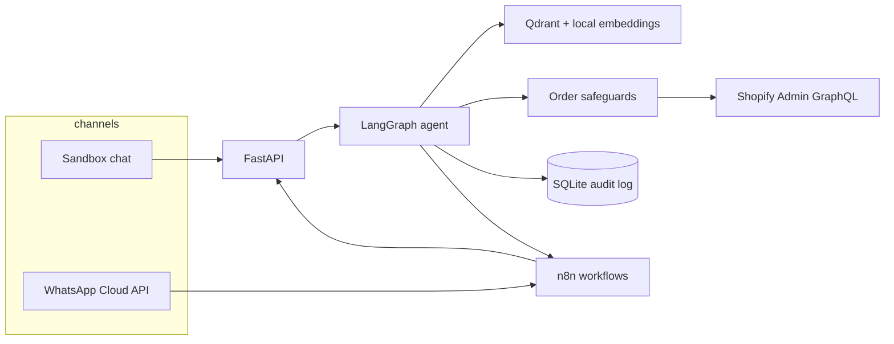

# Harbor & Co. commerce agent

A WhatsApp customer-support and order agent for a small shop. It keeps the conversation, answers from the product catalogue and a policy knowledge base, recommends products, checks live inventory, looks up orders, creates the Shopify customer for the sender's phone, and creates an order only after the customer confirms it on a later message.

The shop in the sandbox is **Harbor & Co.**, a coastal goods catalogue. Shopify and WhatsApp are mocked until you add credentials, so the same code path can be shown to a client without a dev store.

## Run the sandbox

```bash
./scripts/demo.sh
```

That is the only command you need. The first run creates a virtualenv, installs dependencies, and downloads the local embedding model (about 90 MB). Then open:

- [Harbor sandbox](http://127.0.0.1:43123) — fake WhatsApp chat plus the order, audit, and catalogue panels
- [Agent health](http://127.0.0.1:8091/health)

Click **Play demo**. Avery asks about stock and returns, gets a gift recommendation, drafts two medium linen shirts, replies YES, and then asks where the order is. Use **Try a safeguard** to show a missing size, an out-of-stock tote, an order over $500, a lookup of someone else's order, and a handoff to a person.

`APP_MODE` stays `mock`, so nothing calls Shopify or WhatsApp. If `GROQ_API_KEY` is set, Groq (`openai/gpt-oss-120b`) plans the tool calls. If it is empty, the same LangGraph runs a deterministic planner and the header says so. Order gates do not depend on which planner is active.

```bash
./scripts/test.sh
```

## Architecture



WhatsApp can also post straight to `POST /webhooks/whatsapp`. n8n is the automation layer: inbound forwarding, a second check before any downstream order write, customer notification, and error logging. The agent is the component that actually creates the Shopify order, and it tells n8n `already_created: true` so the workflow does not create a second one.

Conversation memory is the message history in SQLite, replayed into the graph on every turn. The model does not get to choose the customer's phone. That comes from the WhatsApp sender, or from the persona selected in the sandbox.

## What a turn does

1. Retrieve policy and catalogue notes from Qdrant.
2. The planner (Groq, or the offline fallback) chooses a tool.
3. Tools re-read the customer's own words and the store. Prices, stock, and identity are not taken from the model.
4. A reply is composed from the tool result. If a live model claims an order was placed and the tool did not create one, that sentence is corrected before it is sent.

| Ask | What happens |
| --- | --- |
| Product, stock, recommendation, policy | Catalogue search, live inventory, or the knowledge base. No order. |
| "I'd like 2 linen shirts in medium" | A draft and a confirmation token. Shopify is not called. |
| "Yes" on the next message | Phone check, stock and price re-check, value cap, duplicate check, then one pending order. |
| Same message asks and confirms | Draft only. A yes has to be its own turn. |
| Another person's order number | Refused. The reply does not describe that order. |
| "I want to talk to a person" | Escalation ticket. Automated orders pause until it is closed. |

## Safeguards

These live in `src/harbor/safeguards.py` and the tool layer, not in the prompt.

- **Confirmation.** `prepare_order` writes a draft. `confirm_order` runs only when the customer's message is an explicit yes (or the draft token). "OK" alone is not enough. The draft's turn id must differ from the current turn.
- **Idempotency.** The key is a hash of the WhatsApp phone and the draft id. It is stored locally and, in live mode, sent as Shopify's `Idempotency-Key`. Confirming twice returns the original order.
- **Duplicate window.** The same lines for the same phone inside 10 minutes are refused unless the customer says they want another order anyway.
- **Phone binding.** Customers and orders are created only for the verified sender. A phone number typed in the message is ignored, and looking up an order owned by someone else is denied.
- **Value cap.** Default $500 (`MAX_ORDER_VALUE`). Over the cap, nothing is created and a person is flagged.
- **Stock and price.** The draft prices come from Shopify (or the mock store). Confirm checks them again, and will not guess a size when a product has S / M / L.
- **Payment.** Orders are created as `PENDING`. The agent never marks an order paid and never sees a card.
- **Audit.** Drafts, denials, creates, duplicates, customer creates, handoffs, and n8n delivery are appended. The audit table has no update API.
- **n8n second gate.** `n8n/workflows/02-order-processing.json` rejects an event whose confirmation is not explicit, whose phone does not match, whose idempotency key is missing, or whose total is over the cap.

## Layout

```
src/harbor/          agent, safeguards, RAG, Shopify, WhatsApp, API
src/harbor/knowledge policy notes ingested into Qdrant
src/harbor/seed      mock Shopify catalogue
web/                 Next.js sandbox (shadcn/ui)
n8n/workflows        importable workflow JSON
tests/               pytest, no API keys required
```

## Configuration

Copy `.env.example` to `.env`. Every provider is chosen with environment variables. There are no secrets in the repo.

| Variable | Purpose |
| --- | --- |
| `APP_MODE` | `mock` (default) or `live` |
| `LLM_PROVIDER` | `groq` (default), `openai`, `gemini`, `ollama`, or `mock` |
| `LLM_MODEL` / `LLM_BASE_URL` | Optional overrides. Blank uses the provider preset. |
| `GROQ_API_KEY` | Groq key. Empty key keeps the offline planner. |
| `EMBEDDING_PROVIDER` | `sentence-transformers` (MiniLM) or `bm25` (in-memory, used on Render) |
| `EMBEDDING_MODEL` | Default `sentence-transformers/all-MiniLM-L6-v2` on CPU when the provider is MiniLM |
| `VECTOR_STORE` | `auto` uses BM25 when `QDRANT_URL` is empty. `qdrant` is the embedded file store. `memory` is always BM25. |
| `QDRANT_URL` | Optional. Set only to point at a Qdrant server. Empty means no separate vector service. |
| `SHOPIFY_STORE_DOMAIN` / `SHOPIFY_ADMIN_TOKEN` | Live Admin API. Ignored while `APP_MODE=mock`. |
| `WHATSAPP_TOKEN` / `WHATSAPP_PHONE_NUMBER_ID` / `WHATSAPP_APP_SECRET` | Cloud API. Sends only in live mode. |
| `N8N_*_WEBHOOK_URL` | Optional. A missed webhook does not roll back an order. |
| `MAX_ORDER_VALUE` | Automatic order cap, in dollars. Default 500. |

Groq preset: `https://api.groq.com/openai/v1`, model `openai/gpt-oss-120b`. OpenAI, Gemini, and Ollama stay available by changing `LLM_PROVIDER` and the matching key. Groq does not offer embeddings, so retrieval does not call it.

## n8n

Start the stack (the n8n UI is on port 5678), then in n8n choose **Import from file** for each JSON file in `n8n/workflows`:

1. `01-whatsapp-inbound.json` — webhook, forward the raw Cloud API body to the agent, log failures.
2. `02-order-processing.json` — re-check confirmation, phone, idempotency, and the value cap. The Shopify write runs only when `already_created` is false.
3. `03-notifications.json` — builds the order text. It calls WhatsApp only when `notify_whatsapp` is true, so the agent's own reply is not sent twice.
4. `04-error-handling-and-logging.json` — error trigger plus an error webhook, both appended to the agent audit log.

Set n8n's `AGENT_BASE_URL` (Compose already sets `http://api:8091`). In the workflow settings, point the error workflow at **Harbor — Errors and audit log**. Activate the workflows, then set `N8N_ORDER_WEBHOOK_URL` to the production URL n8n shows for `harbor-order`.

## Deploy to Render

The free web service is one process. It binds to `$PORT`, serves the API and this sandbox from the same origin, and does not run Qdrant or n8n. Shopify and WhatsApp stay mocked (`APP_MODE=mock`). The only value you type in the dashboard is `GROQ_API_KEY`. Retrieval is an in-memory BM25 index so the instance stays inside the 512 MB limit. MiniLM and PyTorch are not installed on that build.

[](https://render.com/deploy?repo=https://github.com/sharmavijay07/whatsapp-shopify-ai-agent)

Render reads `render.yaml` from the repo.

| | |
| --- | --- |
| Build | `bash scripts/render-build.sh` |
| Start | `uvicorn harbor.api:app --host 0.0.0.0 --port $PORT` |

Required at deploy time: **`GROQ_API_KEY`** (`sync: false` in the blueprint, so Render asks you to paste it). The blueprint already sets `APP_MODE=mock`, `LLM_PROVIDER=groq`, `LLM_MODEL=openai/gpt-oss-120b`, `LLM_BASE_URL=https://api.groq.com/openai/v1`, `VECTOR_STORE=memory`, and `EMBEDDING_PROVIDER=bm25`.

Optional, and unused while the public demo stays mocked: `SHOPIFY_STORE_DOMAIN`, `SHOPIFY_ADMIN_TOKEN`, `WHATSAPP_TOKEN`, `WHATSAPP_PHONE_NUMBER_ID`, `WHATSAPP_APP_SECRET`, `WHATSAPP_VERIFY_TOKEN`, `N8N_ORDER_WEBHOOK_URL`, `N8N_ERROR_WEBHOOK_URL`, `N8N_NOTIFY_WEBHOOK_URL`, `N8N_SHARED_SECRET`, `QDRANT_URL`. Set `APP_MODE=live` only after those store and WhatsApp values exist. A `QDRANT_URL` plus `VECTOR_STORE=qdrant` and `EMBEDDING_PROVIDER=sentence-transformers` opts back into MiniLM, which does not fit the free instance.

After the first deploy, open the Render URL. `GET /health` should show `shopify: mock`, `vector_store: memory`, and `llm.active: groq`.

## Deployment

### This machine, or any host with Python and Node

`./scripts/demo.sh` binds the API on port 8091 and the sandbox on port 43123.

### Docker Compose

```bash
docker compose up --build
```

That starts the API, the sandbox, and n8n. The first image build downloads the embedding model into the image so later starts stay offline. Shopify and WhatsApp stay mocked. Pass `GROQ_API_KEY` in the environment if the planner should be Groq.

For a small VPS, the same Compose file is the deployment. Put a reverse proxy in front of 43123, 8091, and 5678, and set `WEBHOOK_URL` to the public n8n origin so WhatsApp can reach it.

### Go-live checklist

Do this only when the client wants real orders. Until then leave `APP_MODE=mock`.

1. Create a [Shopify development store](https://shopify.dev) and a custom app with `read_products`, `read_orders`, `write_orders`, `read_customers`, `write_customers`. Copy the Admin API access token and the `*.myshopify.com` domain. Set `SHOPIFY_API_VERSION` to the version the store currently offers (the client defaults to `2026-10`).
2. In Meta, create a WhatsApp Business app, add a test number, and set the callback to `https://<public-host>/webhooks/whatsapp` with the verify token from `WHATSAPP_VERIFY_TOKEN`. Set `WHATSAPP_TOKEN`, `WHATSAPP_PHONE_NUMBER_ID`, and `WHATSAPP_APP_SECRET` so signatures are checked.
3. Set `APP_MODE=live` and `GROQ_API_KEY`. Restart. `GET /health` should report `shopify: live`, `whatsapp: live`, and `llm.active: groq`.
4. Import and activate the n8n workflows. Send a WhatsApp message from an allowed test number. Confirm the draft, and confirm the Shopify order is **pending**, not paid.
5. Set `N8N_SHARED_SECRET` so `/api/internal/audit` is not open on the public internet. Keep `/api/sandbox/reset` unreachable from the public proxy; it already refuses to run when Shopify is live.

Mock mode ignores Shopify and WhatsApp credentials on purpose, so a filled-in `.env` cannot place a real order while you are demoing.

## Cost

Mock mode is free: the store is local, WhatsApp is the sandbox UI, Qdrant is embedded, and embeddings run on CPU.

**Groq free tier (default model `openai/gpt-oss-120b`).** A key from [console.groq.com](https://console.groq.com) is enough. Groq's rate-limit docs, checked November 2026, list this model at:

| Limit | Value |
| --- | --- |
| Requests per minute | 30 |
| Requests per day | 1,000 |
| Tokens per minute | 8,000 |
| Tokens per day | 200,000 |

Groq describes that table as a summary. The Limits page in the console is the number that applies to the organization, and a paid Developer plan raises the caps (the same docs show a much higher developer-plan base for this model). Limits are per organization. Input and output tokens both count; cached tokens do not. Crossing a cap returns HTTP 429. This agent does not place or change an order on that error; it tells the customer the model is busy and writes `llm.error` to the audit log. The sandbox sets `LLM_MAX_TOKENS=600` so a chatty reply does not burn the 8,000 token minute by itself.

Groq does not serve embeddings. Retrieval uses `sentence-transformers/all-MiniLM-L6-v2` locally, so there is no embedding bill and no second API key. The model is Apache-2.0 and runs on CPU.

Other optional model hosts (OpenAI, Gemini, a local Ollama server) are a config change, not a code change. A Shopify development store is free. Self-hosted n8n and embedded Qdrant have no vendor fee. WhatsApp Cloud API conversation charges apply only after you leave the test sandbox and message real customers.

## Tests

`./scripts/test.sh` covers confirmation, same-turn blocking, idempotency, the duplicate window, phone binding, the value cap, stock, sizing, escalation, RAG retrieval into Qdrant, the WhatsApp signature and webhook dedupe, the live Shopify GraphQL body (`inventoryBehaviour: DECREMENT_OBEYING_POLICY` and the idempotency header), and the n8n workflow files. No network calls to Groq or Shopify are made.
