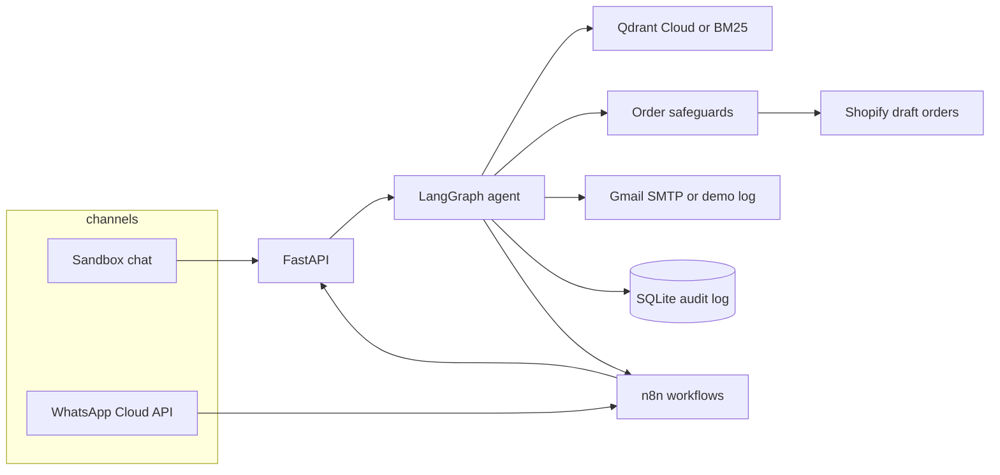

# Harbor & Co. commerce agent

A WhatsApp customer-support and order agent for a small shop. It keeps the conversation, answers from the product catalogue and a policy knowledge base, recommends products, checks live inventory, looks up orders, creates the Shopify customer for the sender's phone, and creates an order only after the customer confirms it on a later message.

The shop in the sandbox is **Harbor & Co.**, a coastal goods catalogue. Shopify and WhatsApp are mocked until you add credentials, so the same code path can be shown to a client without a dev store. The live path is the free-tool checklist at the bottom: a Shopify Partner development store, Meta's WhatsApp test number, Gmail, and optional Qdrant Cloud.

## Run the sandbox

```bash
./scripts/demo.sh
```

That is the only command you need. The first run creates a virtualenv, installs dependencies, and downloads the local embedding model (about 90 MB). Then open:

- [Harbor sandbox](http://127.0.0.1:43123) — fake WhatsApp chat plus the order, audit, and catalogue panels
- [Agent health](http://127.0.0.1:8091/health)

Click **Play demo**. Avery asks about stock and returns, gets a gift recommendation, drafts two medium linen shirts, replies YES, and then asks where the order is. Use **Try a safeguard** to show a missing size, an out-of-stock tote, an order over $500, a lookup of someone else's order, and a handoff to a person.

`APP_MODE` stays `mock`, so nothing calls Shopify or WhatsApp. If `GROQ_API_KEY` is set, Groq (`openai/gpt-oss-120b`) plans the tool calls. If it is empty, the same LangGraph runs a deterministic planner and the header says so. Order gates do not depend on which planner is active.

```bash
./scripts/test.sh
```

## Architecture



WhatsApp can also post straight to `POST /webhooks/whatsapp`. n8n is optional. When its webhook URLs are empty, the agent still confirms orders, sends WhatsApp, and writes the audit log. When n8n is connected it forwards inbound messages, re-checks the order event, and logs errors. The agent completes the Shopify draft itself and tells n8n `already_created: true` so the workflow does not create a second order.

Conversation memory is the message history in SQLite, replayed into the graph on every turn. The model does not get to choose the customer's phone. That comes from the WhatsApp sender, or from the persona selected in the sandbox.

## What a turn does

1. Retrieve policy and catalogue notes from Qdrant.
2. The planner (Groq, or the offline fallback) chooses a tool.
3. Tools re-read the customer's own words and the store. Prices, stock, and identity are not taken from the model.
4. A reply is composed from the tool result. If a live model claims an order was placed and the tool did not create one, that sentence is corrected before it is sent.

| Ask | What happens |
| --- | --- |
| Product, stock, recommendation, policy | Catalogue search, live inventory, or the knowledge base. No order. |
| "I'd like 2 linen shirts in medium" | A confirmation draft. In mock mode it stays in this app. In live mode it is a Shopify draft order. Nothing is paid. |
| "Yes" on the next message, or the YES button | Phone check, live stock and price re-check, value cap, duplicate check, then the draft is completed as a pending order and Shopify is asked to email the invoice. Typed YES still works. |
| Same message asks and confirms | Draft only. A yes has to be its own turn. |
| Another person's order number | Refused. The reply does not describe that order. |
| "I want to talk to a person" | Escalation ticket. Automated orders pause until it is closed. |

## Safeguards

These live in `src/harbor/safeguards.py` and the tool layer, not in the prompt.

- **Confirmation.** `prepare_order` writes a draft and, in live mode, opens a Shopify draft order. `confirm_order` runs only when the customer's message is an explicit yes, the YES reply button, or the draft token. "OK" alone is not enough. The draft's turn id must differ from the current turn. Completing the draft leaves payment pending and sends the Shopify invoice when the customer has an email.
- **Idempotency.** The key is a hash of the WhatsApp phone and the draft id. It is stored locally and, in live mode, sent as Shopify's `Idempotency-Key`. Confirming twice returns the original order.
- **Duplicate window.** The same lines for the same phone inside 10 minutes are refused unless the customer says they want another order anyway.
- **Phone binding.** Customers and orders are created only for the verified sender. A phone number typed in the message is ignored, and looking up an order owned by someone else is denied.
- **Value cap.** Default $500 (`MAX_ORDER_VALUE`). Over the cap, nothing is created and a person is flagged.
- **Stock and price.** The draft prices come from Shopify (or the mock store). Confirm checks them again, and will not guess a size when a product has S / M / L.
- **Payment.** Orders are created as `PENDING`. The agent never marks an order paid and never sees a card.
- **Audit.** Drafts, denials, creates, duplicates, customer creates, handoffs, and n8n delivery are appended. The audit table has no update API.
- **n8n second gate.** `n8n/workflows/02-order-processing.json` rejects an event whose confirmation is not explicit, whose phone does not match, whose idempotency key is missing, or whose total is over the cap.

## Layout

```
src/harbor/          agent, safeguards, RAG, Shopify, WhatsApp, API
src/harbor/knowledge policy notes ingested into Qdrant
src/harbor/seed      mock Shopify catalogue
web/                 Next.js sandbox (shadcn/ui)
n8n/workflows        importable workflow JSON (active: false until you turn them on)
docs/whatsapp-templates.json   utility template to submit in Meta
scripts/seed_dev_store         load the demo catalogue into a Partner dev store
tests/               pytest, no API keys required
```

## Configuration

Copy `.env.example` to `.env`. Every provider is chosen with environment variables. There are no secrets in the repo.

| Variable | Purpose |
| --- | --- |
| `APP_MODE` | `mock` (default) or `live` |
| `LLM_PROVIDER` | `groq` (default), `openai`, `gemini`, `ollama`, or `mock` |
| `LLM_MODEL` / `LLM_BASE_URL` | Optional overrides. Blank uses the provider preset. |
| `GROQ_API_KEY` | Groq key. Empty key keeps the offline planner. |
| `EMBEDDING_PROVIDER` | `bm25` (Render default), `hosted` (Jina or any OpenAI-compatible embeddings API), `fastembed`, or `sentence-transformers` |
| `EMBEDDING_MODEL` | MiniLM locally. `jina-embeddings-v3` for Jina. fastembed defaults to `BAAI/bge-small-en-v1.5` when this is left on the MiniLM name. |
| `EMBEDDING_API_URL` / `EMBEDDING_API_KEY` | Hosted embeddings. Example URL: `https://api.jina.ai/v1`. |
| `VECTOR_STORE` | `memory` forces BM25. `qdrant` is the embedded file or Qdrant Cloud. `auto` uses Cloud when `QDRANT_URL` is set. |
| `QDRANT_URL` / `QDRANT_API_KEY` | Qdrant Cloud. Empty URL keeps BM25. |
| `SHOPIFY_STORE_DOMAIN` / `SHOPIFY_ADMIN_TOKEN` | Live Admin API. Ignored while `APP_MODE=mock`. |
| `SHOPIFY_WEBHOOK_SECRET` | Custom app API secret. Verifies `orders/updated` and fulfillment webhooks. |
| `WHATSAPP_TOKEN` / `WHATSAPP_PHONE_NUMBER_ID` / `WHATSAPP_APP_SECRET` | Cloud API. Sends only in live mode. |
| `WHATSAPP_STATUS_TEMPLATE` | Utility template for order updates outside the 24-hour window. Default `harbor_order_status`. |
| `GMAIL_USER` / `GMAIL_APP_PASSWORD` / `OWNER_EMAIL` | Gmail SMTP on port 465. If the user or app password is empty, email is demo-only (audit log, no SMTP). |
| `N8N_*_WEBHOOK_URL` | Optional. Empty URLs skip n8n. A missed webhook does not roll back an order. |
| `PUBLIC_BASE_URL` | Public https origin. The seed script registers Shopify webhooks here. |
| `MAX_ORDER_VALUE` | Automatic order cap, in dollars. Default 500. |

Groq preset: `https://api.groq.com/openai/v1`, model `openai/gpt-oss-120b`. OpenAI, Gemini, and Ollama stay available by changing `LLM_PROVIDER` and the matching key. Groq does not offer embeddings, so retrieval does not call it.

## n8n

The agent runs with the n8n URLs empty. Nothing in the order path waits on n8n.

Two free ways to run the workflows when you want them:

1. **n8n Cloud trial.** Import each file in `n8n/workflows` (they are saved inactive). In the n8n instance, set `AGENT_BASE_URL` to this service's public URL and `N8N_BLOCK_ENV_ACCESS_IN_NODE=false` if the editor lets you. If the trial blocks `$env`, replace the three agent URLs in the HTTP nodes with `https://<your-host>` after import. Copy each production webhook URL into `N8N_ORDER_WEBHOOK_URL`, `N8N_NOTIFY_WEBHOOK_URL`, and `N8N_ERROR_WEBHOOK_URL`.
2. **Optional Render service.** `render.yaml` includes `harbor-n8n` (Docker, free, `autoDeployTrigger: off`). Deploy that service only if you want it. Set `WEBHOOK_URL` and `N8N_EDITOR_BASE_URL` to its public https origin, then import the same JSON files. The free instance disk is ephemeral, so import again after a spin-down. Docker Compose is the same image for a laptop: `docker compose up`, UI on port 5678, and `N8N_BLOCK_ENV_ACCESS_IN_NODE=false` so `$env` works.

Then in n8n choose **Import from file** for each JSON file in `n8n/workflows`:

1. `01-whatsapp-inbound.json` — webhook, forward the raw Cloud API body to the agent, log failures.
2. `02-order-processing.json` — re-check confirmation, phone, idempotency, and the value cap. The Shopify write runs only when `already_created` is false.
3. `03-notifications.json` — builds the order text. It calls WhatsApp only when `notify_whatsapp` is true, so the agent's own reply is not sent twice.
4. `04-error-handling-and-logging.json` — error trigger plus an error webhook, both appended to the agent audit log.

Set n8n's `AGENT_BASE_URL` (Compose already sets `http://api:8091`). In the workflow settings, point the error workflow at **Harbor — Errors and audit log**. Activate the workflows, then set `N8N_ORDER_WEBHOOK_URL` to the production URL n8n shows for `harbor-order`.

## Deploy to Render

The free web service is one process. It binds to `$PORT`, serves the API and this sandbox from the same origin, and does not run n8n unless you deploy the optional service. Shopify and WhatsApp stay mocked until you set `APP_MODE=live`. Retrieval defaults to an in-memory BM25 index so the instance stays inside the 512 MB limit. MiniLM and PyTorch are not installed on that build. Qdrant Cloud plus a hosted embedding API is the vector option that fits the same instance.

[](https://render.com/deploy?repo=https://github.com/sharmavijay07/whatsapp-shopify-ai-agent)

Render reads `render.yaml` from the repo.

| | |
| --- | --- |
| Build | `bash scripts/render-build.sh` |
| Start | `uvicorn harbor.api:app --host 0.0.0.0 --port $PORT` |

The blueprint sets `APP_MODE=mock`, `LLM_PROVIDER=groq`, `LLM_MODEL=openai/gpt-oss-120b`, `LLM_BASE_URL=https://api.groq.com/openai/v1`, `VECTOR_STORE=memory`, and `EMBEDDING_PROVIDER=bm25`. Secrets and the values Don changes at go-live are `sync: false`, so a later blueprint sync does not overwrite them. On a service that already exists, Render does not prompt again for new `sync: false` keys: add those in the Dashboard by hand.

`GET /health` on the public demo shows `shopify: mock`, `whatsapp: mock`, `email: demo`, `n8n: off`, `vector_store: memory`.

MiniLM (`EMBEDDING_PROVIDER=sentence-transformers`) is forced back to BM25 on Render even if `QDRANT_URL` is set. Use `hosted` or `fastembed` with `VECTOR_STORE=qdrant`.

## Deployment

### This machine, or any host with Python and Node

`./scripts/demo.sh` binds the API on port 8091 and the sandbox on port 43123.

### Docker Compose

```bash
docker compose up --build
```

That starts the API, the sandbox, and n8n. The first image build downloads the embedding model into the image so later starts stay offline. Shopify and WhatsApp stay mocked. Pass `GROQ_API_KEY` in the environment if the planner should be Groq.

For a small VPS, the same Compose file is the deployment. Put a reverse proxy in front of 43123, 8091, and 5678, and set `WEBHOOK_URL` to the public n8n origin so WhatsApp can reach it.

### Go live with free tools

Do this when Don wants real drafts on a development store. Until then leave `APP_MODE=mock`. Mock mode ignores Shopify and WhatsApp credentials on purpose, so a filled-in `.env` cannot place a real order while you are demoing.

Every value below is free. No paid Shopify plan, no paid WhatsApp number, no paid vector database, no paid mailbox.

| Env var | What Don pastes | Required to go live |
| --- | --- | --- |
| `GROQ_API_KEY` | Groq key | Yes, for the model. Empty keeps the offline planner. |
| `APP_MODE` | `live` | Yes |
| `SHOPIFY_STORE_DOMAIN` | `something.myshopify.com` | Yes |
| `SHOPIFY_ADMIN_TOKEN` | Admin API access token (`shpat_...`) | Yes |
| `SHOPIFY_WEBHOOK_SECRET` | Custom app API secret key | Yes, or order webhooks are rejected |
| `PUBLIC_BASE_URL` | `https://whatsapp-shopify-ai-agent.onrender.com` | Yes, so the seed script can register webhooks |
| `WHATSAPP_TOKEN` | Temporary access token from the API setup screen | Yes |
| `WHATSAPP_PHONE_NUMBER_ID` | Phone number ID under the test number | Yes |
| `WHATSAPP_APP_SECRET` | App secret from the Meta app settings | Yes |
| `WHATSAPP_VERIFY_TOKEN` | Any string Don chooses; the same string goes in the Meta callback form | Yes |
| `GMAIL_USER` | The Gmail address that sends | For real email. Empty keeps demo mode. |
| `GMAIL_APP_PASSWORD` | 16-character app password | Same |
| `OWNER_EMAIL` | Don's inbox for order copies and handoff alerts | Same |
| `VECTOR_STORE` | `qdrant` | Only for vector search. Leave `memory` for BM25. |
| `EMBEDDING_PROVIDER` | `hosted` | Only with Qdrant. Leave `bm25` otherwise. |
| `EMBEDDING_API_URL` | `https://api.jina.ai/v1` | With hosted embeddings |
| `EMBEDDING_API_KEY` | Jina key | With hosted embeddings |
| `EMBEDDING_MODEL` | `jina-embeddings-v3` | With hosted embeddings |
| `QDRANT_URL` | `https://<cluster>.cloud.qdrant.io:6333` | With Qdrant Cloud |
| `QDRANT_API_KEY` | Qdrant Cloud API key | With Qdrant Cloud |
| `N8N_ORDER_WEBHOOK_URL` | n8n production URL for `harbor-order` | No |
| `N8N_NOTIFY_WEBHOOK_URL` | n8n production URL for `harbor-notify` | No |
| `N8N_ERROR_WEBHOOK_URL` | n8n production URL for `harbor-error` | No |
| `N8N_SHARED_SECRET` | Shared random string | No, but set it before exposing `/api/internal/audit` |

`SHOPIFY_API_VERSION` stays `2026-10` unless the dev store's Admin API says otherwise. `WHATSAPP_STATUS_TEMPLATE` stays `harbor_order_status`.

#### 1. Shopify Partner development store

1. Open [Shopify Partners](https://partners.shopify.com) and create a free partner account.
2. Stores → Add store → Development store. Name it whatever Don likes. This store is free and does not bill customers.
3. In the dev store admin: Settings → Apps and sales channels → Develop apps → Create an app (`Harbor agent`).
4. Configuration → Admin API scopes. Enable `read_products`, `write_products`, `read_inventory`, `write_inventory`, `read_locations`, `read_orders`, `write_orders`, `read_draft_orders`, `write_draft_orders`, `read_customers`, `write_customers`, `read_fulfillments`.
5. Install the app. Reveal the Admin API access token once and save it as `SHOPIFY_ADMIN_TOKEN`. The API secret key on the same credentials page is `SHOPIFY_WEBHOOK_SECRET` (it is not the access token).
6. `SHOPIFY_STORE_DOMAIN` is the `*.myshopify.com` host on the store admin, without `https://`.
7. From a machine that has the repo and those two variables:

```bash
export SHOPIFY_STORE_DOMAIN=your-store.myshopify.com
export SHOPIFY_ADMIN_TOKEN=shpat_...
export PUBLIC_BASE_URL=https://whatsapp-shopify-ai-agent.onrender.com
export SHOPIFY_API_VERSION=2026-10
python3 scripts/seed_dev_store
```

That creates the Harbor catalogue (SKUs, prices, inventory) and registers `orders/updated`, `fulfillments/create`, and `fulfillments/update` to `PUBLIC_BASE_URL/webhooks/shopify`. Re-running skips products whose SKUs already exist. If webhook registration fails, add the same three topics by hand under Settings → Notifications → Webhooks, format JSON, URL `https://whatsapp-shopify-ai-agent.onrender.com/webhooks/shopify`.

#### 2. Meta WhatsApp test number

1. Open [Meta for Developers](https://developers.facebook.com/) and create a free app of type Business.
2. Add the WhatsApp product. The API setup screen gives a free test number, a temporary access token, and a phone number ID.
3. `WHATSAPP_TOKEN` is that temporary token (Meta rotates test tokens; generate a system-user token later if the test token expires). `WHATSAPP_PHONE_NUMBER_ID` is the phone number ID, not the phone number itself.
4. App settings → Basic → App secret is `WHATSAPP_APP_SECRET`.
5. Choose a `WHATSAPP_VERIFY_TOKEN` (the default in `.env.example` is `harbor-verify`). WhatsApp → Configuration → Callback URL `https://whatsapp-shopify-ai-agent.onrender.com/webhooks/whatsapp`, verify token the same string. Subscribe to the `messages` field.
6. Add Don's mobile phone as a test recipient on the API setup screen. The test number only messages numbers on that list.
7. Submit the utility template in `docs/whatsapp-templates.json` before order-status webhooks can be delivered outside the 24-hour window. WhatsApp Manager → Message templates → Create, category Utility, name `harbor_order_status`, language English (US), body:

   `Harbor & Co. update for order {{1}}. Status: {{2}}. Details: {{3}}. Reply here if you need help.`

   Sample values: `10421`, `fulfilled`, `Tracking: 1Z999AA10123456784.` Wait until Meta marks it Approved. Inside the 24-hour window the agent sends normal messages, YES/NO buttons, and a product list. Typed YES is the fallback when the button is not used.

#### 3. Gmail app password

1. Use a normal free Gmail account. Google Account → Security → turn on 2-Step Verification (required before app passwords exist).
2. Security → App passwords → create one named `Harbor agent`. Google shows 16 characters. That is `GMAIL_APP_PASSWORD`. Spaces in the pasted value are ignored.
3. `GMAIL_USER` is the full Gmail address. `OWNER_EMAIL` is where order copies and "customer asked for a person" alerts go (the same address is fine).
4. If either `GMAIL_USER` or `GMAIL_APP_PASSWORD` is empty, the agent writes the email to the audit log and does not open SMTP. `GET /health` shows `email: demo` until both are set, then `email: live` after a restart.

Order confirmations go to `OWNER_EMAIL` and to the customer when the chat included an email. Shopify's own invoice is a separate email from `orderInvoiceSend`, sent only when that customer email exists.

#### 4. Qdrant Cloud and embeddings

Skip this whole step to keep BM25. The catalogue and the policy notes still answer.

1. Create a free cluster at [Qdrant Cloud](https://cloud.qdrant.io/). The free tier is one 1 GB cluster.
2. `QDRANT_URL` is the cluster HTTPS endpoint, including `:6333`. `QDRANT_API_KEY` is an API key from the cluster's access page.
3. Create a free key at [Jina AI](https://jina.ai/embeddings/). Set `EMBEDDING_PROVIDER=hosted`, `EMBEDDING_API_URL=https://api.jina.ai/v1`, `EMBEDDING_API_KEY` to that key, `EMBEDDING_MODEL=jina-embeddings-v3`, and `VECTOR_STORE=qdrant`.
4. Restart. `GET /health` should show `vector_store: qdrant`. If the embedding call fails, the process logs a warning and answers with BM25 instead of crashing.
5. Alternative with no embedding API: `pip install 'harbor-agent[vectors]'` and `EMBEDDING_PROVIDER=fastembed`. That downloads `BAAI/bge-small-en-v1.5`. On the 512 MB Render instance prefer Jina. MiniLM is not used there.

#### 5. Turn live mode on

1. In the Render dashboard set `APP_MODE=live` and the variables from the table. Manual deploy, or let the next push deploy.
2. `GET /health` should show `shopify: live`, `whatsapp: live`, and `llm.active: groq` once `GROQ_API_KEY` is set.
3. From a phone on the Meta test list, ask for a sea salt candle. The reply has YES and NO buttons. Tap YES, or type YES. In Shopify admin the order is a real order created from a draft, financial status pending, not paid. The invoice email goes out when the customer message included an email address.
4. n8n stays optional. Import and activate the four workflows only if Don wants that layer. Set `N8N_SHARED_SECRET` to the same value on the agent and on n8n so `/api/internal/audit` is not open.
5. `/api/sandbox/reset` already refuses to run when Shopify is live.

Groq's free key comes from [console.groq.com](https://console.groq.com). The model stays `openai/gpt-oss-120b`.

## Cost

Mock mode is free: the store is local, WhatsApp is the sandbox UI, and retrieval is BM25 or embedded Qdrant. The go-live checklist above stays on free tiers: Shopify Partner development store, Meta's test number, Gmail, Groq, Qdrant Cloud's free cluster, and Jina's free embeddings. n8n is either omitted, the Cloud trial, or the optional free Render service.

**Groq free tier (default model `openai/gpt-oss-120b`).** A key from [console.groq.com](https://console.groq.com) is enough. Groq's rate-limit docs, checked November 2026, list this model at:

| Limit | Value |
| --- | --- |
| Requests per minute | 30 |
| Requests per day | 1,000 |
| Tokens per minute | 8,000 |
| Tokens per day | 200,000 |

Groq describes that table as a summary. The Limits page in the console is the number that applies to the organization, and a paid Developer plan raises the caps (the same docs show a much higher developer-plan base for this model). Limits are per organization. Input and output tokens both count; cached tokens do not. Crossing a cap returns HTTP 429. This agent does not place or change an order on that error; it tells the customer the model is busy and writes `llm.error` to the audit log. The sandbox sets `LLM_MAX_TOKENS=600` so a chatty reply does not burn the 8,000 token minute by itself.

Groq does not serve embeddings. Locally, retrieval can use `sentence-transformers/all-MiniLM-L6-v2` (Apache-2.0, CPU). On Render's free instance the default is BM25. Qdrant Cloud plus Jina (or fastembed) is the vector path that fits 512 MB. A failed embedding setup falls back to BM25.

Other optional model hosts (OpenAI, Gemini, a local Ollama server) are a config change, not a code change. A Shopify development store is free. WhatsApp Cloud API conversation charges apply only after you leave Meta's test number and message customers who are not on the test list. The test number itself does not bill.

## Tests

`./scripts/test.sh` covers confirmation, same-turn blocking, idempotency, the duplicate window, phone binding, the value cap, stock, sizing, escalation, RAG retrieval, the WhatsApp signature and webhook dedupe, YES/NO buttons, product lists, the status template, Gmail demo mode and SMTP, Shopify draft create/complete/invoice, the dev-store seed, order webhooks with HMAC, hosted embeddings with a BM25 fallback, the live `orderCreate` body (`inventoryBehaviour: DECREMENT_OBEYING_POLICY` and the idempotency header), and the n8n workflow files. No network calls to Groq, Shopify, Meta, Gmail, or Qdrant are made.
